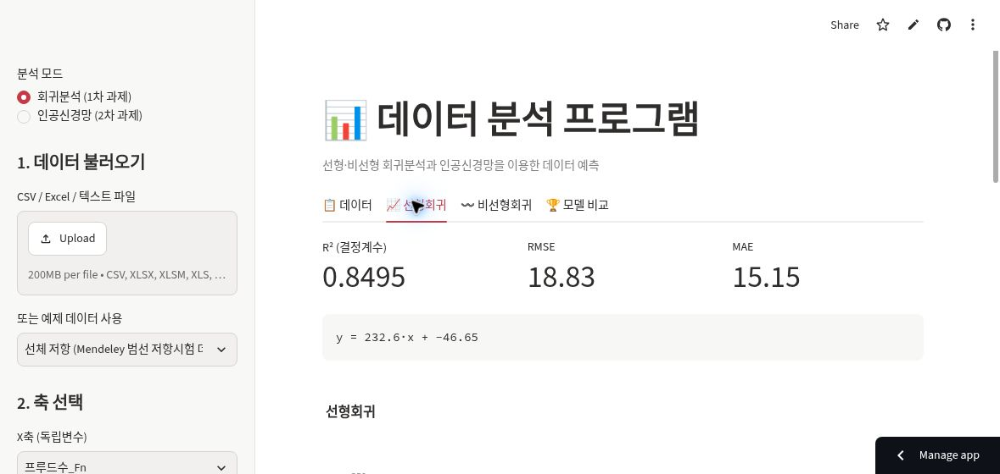
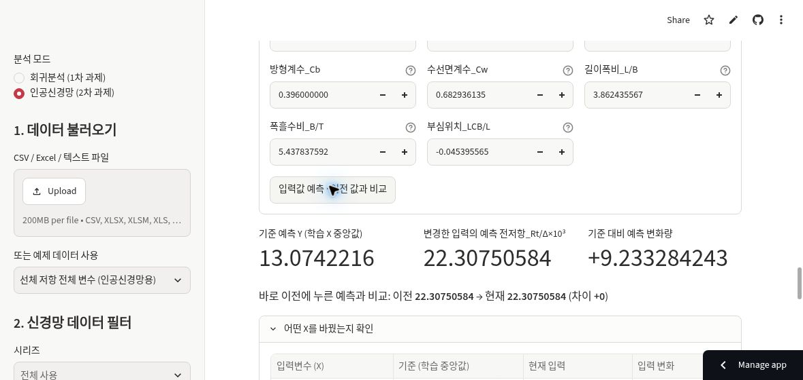

# 1·2차 과제 분리·복원 기록

- 기준: `680c8b7`의 `legacy_app.py`를 `app.py`로 그대로 복원
- 회귀 계산: 기존 `core/regression.py` 유지
- 신경망 계산 및 화면: 기존 `models/neural_network.py`, `ui/ann_page.py` 유지
- 예제 데이터: 기존 두 CSV 유지
- 독립 배포: `assignments-1-2` 브랜치, `app.py`
- 마지막 과제: 기존 `main` 브랜치와 Data Lab 주소 유지
- 이 브랜치에는 공개 LLM 실행 모듈이나 모델 다운로드 의존성이 없음

새 공개 사이트 배포 완료: [https://junwon-data-analyzer-classic.streamlit.app/](https://junwon-data-analyzer-classic.streamlit.app/)

## 실제 개발 환경 검증

Python 3.14.10에서 자동 검사 **28개 통과**. 회귀 예제 표시, 신경망 학습·새 입력 예측·입력 변경 시 결과 무효화, 구조 비교, 데이터 분리와 누수 검사를 수행했다. `app.py`가 보관된 `legacy_app.py`와 바이트 단위로 같고, 계산·신경망 화면 모듈도 변경되지 않았음을 SHA-256으로 대조했다.

`scripts/verify_ann.py`의 기본 설정으로 공개 데이터 1,018행을 실제 학습했다. 학습 640행·검증 176행·테스트 202행, 테스트 R² 0.972433, RMSE 8.601426이었다. 이 값은 해당 스크립트의 기본 목표값 변환·설정으로 실행한 결과이며, Data Lab의 로그 목표값 변환 실험과 다른 조건이다.

- [자동 검사 원문](restoration_tests.txt)
- [기본 스크립트 실행 결과](restoration_default_run.txt)

개발 환경 검사와 별도로, 아래 공개 사이트 실행을 확인했다.

## 공개 서버 실행 확인

Streamlit Community Cloud에 별도 앱을 배포했다. 기존 Data Lab과 다른 주소 및 브랜치를 사용한다.

| 앱 | 주소 | 배포 브랜치 |
|---|---|---|
| 1·2차 과제 보존판 | https://junwon-data-analyzer-classic.streamlit.app/ | assignments-1-2 |
| 마지막 과제 Data Lab | https://data-analyzer-farcyhew6tpc7bdizm6rvw.streamlit.app/ | main |

새 공개 앱에서 회귀 예제를 선택해 선형회귀(R² 0.8495), 2차 다항회귀(R² 0.8723)를 확인했다. 이어서 신경망 모드에서 입력 8개, 은닉층 64–32–16, 로그 목표값 변환, 그룹별 분리, 최대 500 epoch, 시드 42로 학습했다. 실제 157 epoch 후 종료되었고 검증 오차가 가장 작았던 117 epoch의 가중치를 채택했다. 테스트 R² 0.9258856675, RMSE 14.1035228229, MAE 8.0102667936이었다.

다른 입력을 기본값으로 둔 상태에서 프루드수를 학습 중앙값에서 0.4로 변경하고 예측했다. 기준 예측 13.0742216, 변경 예측 22.30750584, 기준 대비 변화량 +9.233284243이 표시되었다. 신경망 입력값 변경과 예측이 작동함을 확인한 것이며, 새 선박에 대한 실측 검증은 아니다.

기존 Data Lab 주소에서도 대화형 첫 화면이 그대로 표시됨을 확인했다. 마지막 과제의 main 브랜치와 앱 실행 코드는 수정하지 않았다.

## 2차 과제 직접 진입 링크

2차 과제의 링크는 https://junwon-data-analyzer-classic.streamlit.app/?mode=ann 이다. 처음 접속할 때 인공신경망 모드가 선택된다. 이후 사용자가 화면에서 회귀분석으로 전환하는 것도 가능하다. 이를 위해 앱의 초기 모드 선택만 추가했으며 계산 모듈은 수정하지 않았다. 링크 직접 진입·수동 전환을 포함한 자동 검사 29개가 통과했다. GitHub의 2차 과제 설명서와 노션 보고서에서도 이 주소를 사용한다.
