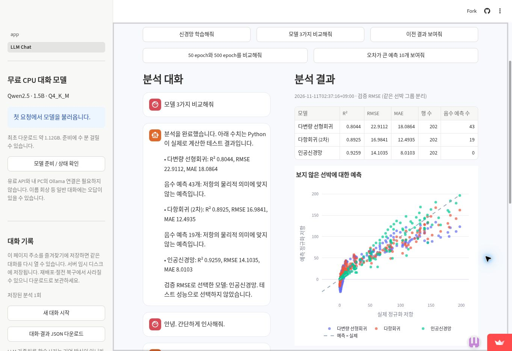
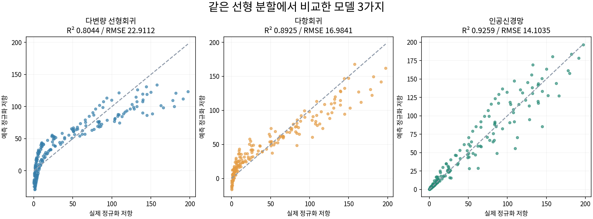
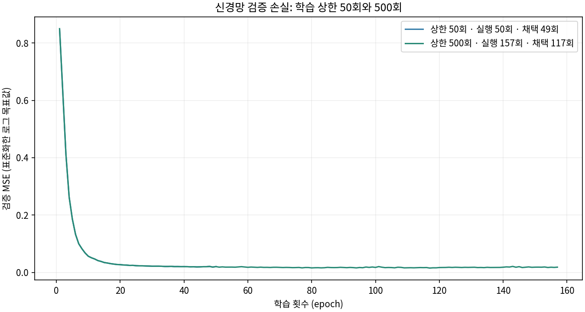

# 2026-11-11 실행 점검

- 화면의 ‘세 모델’을 ‘모델 3가지’로 명확하게 수정했다. 비교 대상은 선형회귀, 다항회귀, 인공신경망이다.
- 현재 CPU 실행 방식과 맞지 않는 미사용 Ollama 안내를 제거했다.
- 좁은 결과 영역에서 그래프 제목과 범례가 겹치지 않도록 범례를 아래로 옮겼다.
- Python 3.12: pytest 45개 통과. 테스트 도구 anyio의 향후 pytest 호환성 경고 1개가 있었다.
- Python 3.14.10: requirements-dev.txt 설치 성공, pytest 45개 통과.
- 범례 배치 수정 후 Python 3.14 AppTest로 결과 패널과 Plotly 차트 표시를 추가 확인했다.
- 공개 Streamlit 앱: 로그인 없이 기본 페이지와 LLM Chat 접속, ‘모델 3가지 비교해줘’로 실제 LLM 동작 선택·분석 실행·표·그래프 표시 확인. 이후 ‘안녕. 간단하게 인사해줘.’에 ‘안녕하세요. 어떻게 도와드릴까요?’ 응답 확인.
- 모델 비교 수치는 공개 앱과 로컬에서 소수 넷째 자리까지 일치했다.
- 전체 입력 표현, 동시 사용자 부하, 장기 가동을 모두 검증한 것은 아니다. 기존 이름 회상 실패 한계도 해소했다고 주장하지 않는다.

## 결과 이미지

그림은 생성형 이미지가 아니라 실제 실행 화면 및 실제 계산 결과다. 그래프의 원수치는 comparison.json, epochs.json에 남겼다. 그래프 재생성은 저장소 루트에서 `python scripts/build_review_figures.py`로 실행한다(그림 생성에는 matplotlib와 Noto CJK 글꼴 필요).
