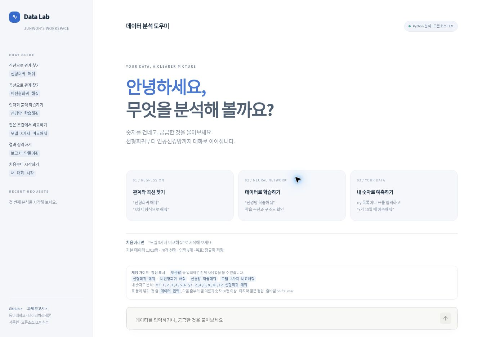
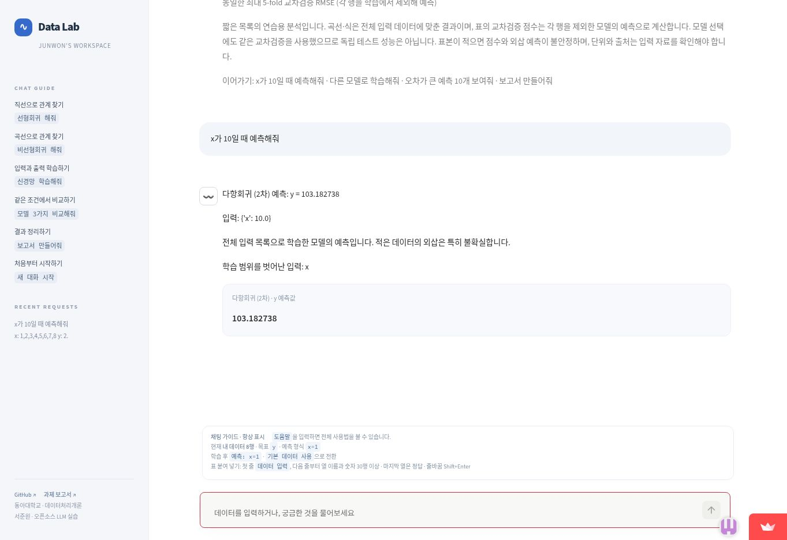

# Data Lab 화면·대화 흐름 개편

참고: https://onejunpyo.github.io/Han-s_Chatbot_ALPHA_version/

참고 사이트의 공개 화면과 README·소스를 읽고, 회귀 실행 및 후속 예측 흐름을 확인했다. 사이트의 HTML·JavaScript를 복사하지 않고 기존 Python 프로그램을 확장했다.

## 적용한 동작

- 왼쪽 안내 영역, 여백 있는 첫 화면, 하단 대화 입력창
- 버튼으로 분석을 선택할 필요 없이 문장으로 실행
- 항상 보이는 채팅 가이드와 현재 데이터 표시
- 요청한 답변 아래에 실제 표·그래프·예측값을 붙이는 대화 기록
- x·y 숫자 목록 입력 → 모델 비교 → `x가 10일 때 예측해줘`
- 짧은 단변량 목록: 최소 6쌍. 최대 5-fold 교차검증으로 비교. 회귀식과 전체 데이터 적합 곡선을 표시
- 기존 CSV/엑셀 탭 구분 표: 30~1000행, 1~8개 입력변수와 마지막 목표 열
- 기존 공개 선체 데이터와 선형회귀·다항회귀·인공신경망 계산 유지
- 신경망 구조와 실제 학습 손실 곡선 표시
- 일반 대화는 기존 Qwen 공개 모델로 실행. 명시적인 숫자 입력·분석·예측 명령은 숫자를 검사한 뒤 직접 계산

## 검증

Python 3.14.10에서 자동 검사 63개 통과. 기본 데이터의 계산·분리, 사용자 표, 숫자 목록·회귀식·후속 예측, 잘못된 입력, 방문자 분리, 결과가 중복 생성되지 않는 대화 화면을 검사했다. 명시적 숫자 명령 검사는 LLM이 없어도 실제 Python 계산으로 실행되도록 검사했다.

브라우저 확인: 개발 미리보기에서 직접 8쌍 입력으로 세 모델을 비교했다. 교차검증 R²는 선형 0.904654, 2차 다항회귀 0.998617, 신경망 0.981159였다. 위 값은 참고 프로그램의 동일 데이터 적합 점수와 평가 방식이 다르므로 직접 성능 우열로 비교하면 안 된다.

작은 목록의 교차검증은 모델 선택에도 사용하므로 독립 최종 테스트가 아니다. 적은 데이터와 외삽 예측의 불확실성을 화면과 보고서에 표시한다. 전체 입력에 적합한 식은 y = 1.09821·x² − 0.799405·x + 1.35536이다.

무료 실행 방식을 유지해 외부 유료 API·브라우저에서의 비밀키 입력은 추가하지 않았다. 앱 안의 GitHub·Notion 링크는 프로젝트 소스·보고서로 이동한다. 참고 사이트의 외부 계정 연결, 파일 요약·음성 입력·웹 검색을 구현했다고 주장하지 않는다.

## 공개 서버 확인

새 버전의 공개 Streamlit 앱에서 동일한 8쌍 입력을 전송해 선형·다항회귀·신경망의 표와 그래프를 확인했다. 개발 환경과 소수 넷째 자리 결과가 같았고, 현재 데이터 8행 가이드가 계속 표시되었다. 이후 x=10의 후속 예측도 확인했다.

